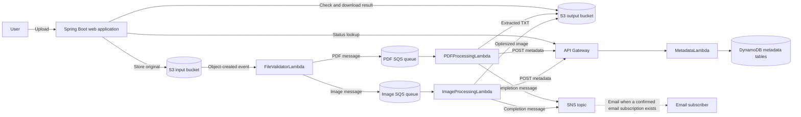

# AWS Serverless File Processing

A Java-based file-processing application that combines a Spring Boot web interface with AWS services. Users upload image and PDF files through the web app; AWS Lambda workers process supported files asynchronously, save results to S3, and publish metadata and completion notifications.

## Problem Statement

Processing uploaded files synchronously can make an application slow and difficult to scale. This project separates upload from processing: the web application stores the original in S3, and event-driven Lambda workers process supported formats independently. The processed file and its metadata can then be retrieved by the application.

## Implemented Features

- Upload a file from the Spring Boot web application to the configured S3 input bucket.
- Classify S3 uploads and route supported image and PDF files through separate SQS queues.
- Resize oversized JPG, JPEG, and PNG images when the resized result is smaller.
- Extract selectable text from PDFs into UTF-8 text files. Scanned-document OCR is not implemented.
- Store processed files in the S3 output bucket.
- Write and retrieve image and PDF processing metadata through API Gateway, a Lambda handler, and DynamoDB.
- Publish completion messages to SNS after processing.
- Check processing status and download processed output from the web application.

The web application limits uploads to 10 MB. The file validator currently routes JPG, JPEG, PNG, and PDF files; other types such as DOCX and TXT are classified but are not processed.

## Architecture and Workflow



1. A user selects and uploads a file in the Spring Boot web application.
2. The application stores the original file in the configured S3 input bucket and returns its S3 object key.
3. An S3 object-created event invokes `FileValidatorLambda`. The validator classifies the extension and sends supported image or PDF files to the corresponding SQS queue.
4. `ImageProcessingLambda` consumes image messages and may resize oversized images. `PDFProcessingLambda` consumes PDF messages and extracts selectable text.
5. Each processor stores its output in the S3 output bucket.
6. Each processor posts processing metadata through API Gateway to `MetadataLambda`, which stores it in the appropriate DynamoDB table.
7. Each processor publishes a completion message to SNS. Email delivery requires an email endpoint to be subscribed to the SNS topic and to have confirmed that subscription.
8. The web application can query metadata and check the output object to report status and serve the processed file for download.

The repository contains application and Lambda code, but does not include infrastructure-as-code or AWS resource provisioning. S3 event notifications, queue-to-Lambda event source mappings, API Gateway routes, DynamoDB tables, SNS topic, and any email subscription must be configured in AWS.

## Technologies

- Java 21
- Spring Boot and Thymeleaf
- Apache Maven and Maven Wrapper
- AWS SDK for Java v2
- Amazon S3, AWS Lambda, Amazon SQS, Amazon DynamoDB, Amazon API Gateway, and Amazon SNS
- Thumbnailator for image resizing
- Apache PDFBox for PDF text extraction

## Project Structure

```text
fileprocessing/
├── .env.example
├── mvnw
├── mvnw.cmd
├── pom.xml                         # Spring Boot web application
├── src/
│   ├── main/
│   │   ├── java/com/vishwa/fileprocessing/
│   │   │   ├── config/             # S3 client configuration
│   │   │   ├── controller/         # Web pages and file endpoints
│   │   │   └── service/            # S3 upload/download and metadata API clients
│   │   └── resources/
│   │       ├── templates/          # Thymeleaf pages
│   │       └── application.properties
│   └── test/                       # Web application tests
├── file-validator/                 # S3 event classifier and SQS router Lambda
│   ├── pom.xml
│   └── src/main/java/
├── image-processor/                # SQS-triggered image processing Lambda
│   ├── pom.xml
│   └── src/main/java/
├── pdf-processor/                  # SQS-triggered PDF text extraction Lambda
│   ├── pom.xml
│   └── src/main/java/
└── metadata-service/               # API Gateway metadata Lambda and tests
    ├── pom.xml
    └── src/
        ├── main/java/
        └── test/java/
```

The root `pom.xml` builds the Spring Boot web application. Each Lambda module has its own Maven project and is packaged separately.

## Configuration

Copy `.env.example` as a reference and replace its placeholder values with values for your own AWS environment. The example file documents these variables, but Spring Boot and Lambda do not automatically load a `.env` file. Set variables in your shell, IDE launch configuration, or the corresponding Lambda configuration.

| Variable | Used by | Purpose |
| --- | --- | --- |
| `S3_INPUT_BUCKET` | Spring Boot application | S3 bucket for original uploads. |
| `OUTPUT_BUCKET` | Spring Boot application and image/PDF Lambdas | S3 bucket for processed output. |
| `METADATA_API_URL` | Spring Boot application and image/PDF Lambdas | API Gateway metadata endpoint. The application appends a file ID when looking up metadata. |
| `AWS_REGION` | Application and Lambda modules | AWS Region for service clients. |
| `IMAGE_QUEUE_URL` | `FileValidatorLambda` | SQS queue URL for supported image uploads. |
| `PDF_QUEUE_URL` | `FileValidatorLambda` | SQS queue URL for PDF uploads. |
| `SNS_TOPIC_ARN` | Image and PDF processor Lambdas | SNS topic for completion messages. |
| `IMAGE_TABLE` | `MetadataLambda` | DynamoDB image metadata table; optional, defaults to `ImageProcessingMetadata`. |
| `PDF_TABLE` | `MetadataLambda` | DynamoDB PDF metadata table; optional, defaults to `PDFProcessingMetadata`. |

For a local web application run in PowerShell, set its required variables before starting Maven:

```powershell
$env:S3_INPUT_BUCKET = "your-input-bucket"
$env:OUTPUT_BUCKET = "your-output-bucket"
$env:METADATA_API_URL = "https://<api-id>.execute-api.<region>.amazonaws.com/<stage>/metadata"
$env:AWS_REGION = "<region>"
```

The local application uses the AWS SDK default credentials provider. Configure AWS credentials through your normal local AWS profile or credential provider; credentials are not stored in `.env.example`. The Lambda environment variables belong in each deployed function's configuration.

## Build and Run Locally

Requirements: JDK 21 and the AWS resources and credentials needed by the part of the application being run.

From the project root, build and test the Spring Boot application:

```powershell
.\mvnw.cmd clean package
```

Build each Lambda module separately to create its deployment JAR:

```powershell
.\mvnw.cmd -f file-validator\pom.xml clean package
.\mvnw.cmd -f image-processor\pom.xml clean package
.\mvnw.cmd -f pdf-processor\pom.xml clean package
.\mvnw.cmd -f metadata-service\pom.xml clean package
```

After setting the web application's environment variables and configuring local AWS credentials, run the web application:

```powershell
.\mvnw.cmd spring-boot:run
```

Open `http://localhost:8080`. The upload page is served by the Spring Boot application. Building a Lambda JAR does not deploy or invoke that function; deploy the JAR and configure its AWS triggers and permissions separately.

## AWS Services and Responsibilities

| Service | Responsibility in this project |
| --- | --- |
| Amazon S3 | Stores original uploads in the input bucket and processed images/text files in the output bucket. An object-created event starts validation. |
| AWS Lambda | Runs `FileValidatorLambda`, `ImageProcessingLambda`, `PDFProcessingLambda`, and `MetadataLambda`. |
| Amazon SQS | Separates image and PDF processing work into their respective queues. |
| Amazon API Gateway | Exposes the metadata API handled by `MetadataLambda`; the web application also uses it for metadata lookups. |
| Amazon DynamoDB | Stores image and PDF metadata in separate tables. |
| Amazon SNS | Receives completion messages from the image and PDF processors. A confirmed email subscription can deliver those messages by email. |

## Screenshots

Screenshots are not included yet. Add them here when available:

- **Upload page:** `docs/screenshots/upload-page.png`
- **Processing status/result:** `docs/screenshots/processing-result.png`

## Future Enhancements

The following are ideas for future work, not implemented features:

- Add infrastructure-as-code and deployment automation for the AWS resources and event integrations.
- Add authentication and authorization for the web application and metadata API.
- Add OCR support for scanned PDFs.
- Consider Step Functions if processing later requires explicit multi-step orchestration.
- Add dead-letter queues and operational dashboards/alarms for failed processing.
